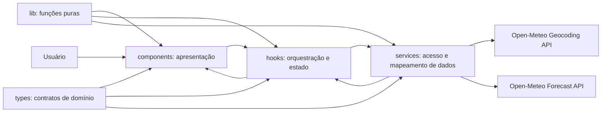
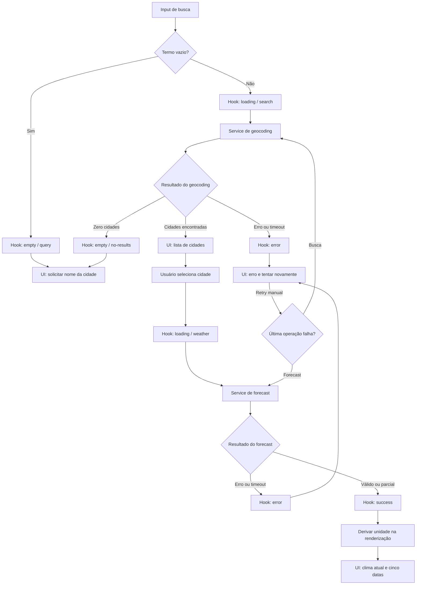

# Plano Técnico — Weather App

## Architecture

Aplicação React client-side sem backend próprio. O browser consulta diretamente a Open-Meteo, que não requer API key para os endpoints definidos. A arquitetura separa apresentação, orquestração, I/O e funções puras com dependências unidirecionais: `components -> hooks -> services`; `components`, `hooks` e `services` podem consumir `lib` e `types` conforme necessário. `lib` não depende de React, rede ou estado global.



Responsabilidades:

- **Apresentação (`components/`):** renderizar props e emitir eventos; controlar formulário e interação visual. Não chamar APIs nem decidir regras de domínio.
- **Orquestração (`hooks/`):** coordenar busca, seleção explícita, carregamento, retry e transições de estado; descartar respostas obsoletas. Não construir URLs nem interpretar payloads externos.
- **Acesso a dados (`services/`):** encapsular fetch, timeout, validação e mapeamento da Open-Meteo para tipos internos. Não conhecer componentes ou estado React.
- **Funções puras (`lib/`):** concentrar conversão/arredondamento de temperatura, formatação de datas/números e interpretação de códigos WMO. Mesma entrada deve produzir a mesma saída, sem I/O ou mutação compartilhada.
- **Contratos (`types/`):** definir modelos de domínio compartilhados. DTOs específicos da API permanecem privados no serviço.

Regras de dependência: componente não importa serviço; hook pode importar serviço; serviço pode importar tipos e funções puras; nenhuma camada inferior importa camada superior. Temperaturas são mantidas em Celsius; conversão e arredondamento ocorrem somente na apresentação.

Não adicionar backend, cache persistente, armazenamento local, biblioteca de estado ou dependência de runtime para validação de schema nesta fase.

## Tech Stack

- **TypeScript strict, React 19 e Vite 8:** stack já instalada para UI tipada e desenvolvimento/build client-side.
- **Tailwind CSS 3:** estilização responsiva já adotada no projeto.
- **Vitest 4, Testing Library e jsdom:** testes unitários e de componentes existentes.
- **Playwright 1.61:** testes de fluxos de navegador existentes.
- **Biome 2.5:** lint e verificações de código existentes.
- **Fetch, AbortController e URLSearchParams nativos:** suficientes para as chamadas REST e timeout; não adicionar cliente HTTP.
- **Open-Meteo:** geocoding e previsão sem API key. Confirmar termos, atribuição e limites operacionais antes do lançamento.

## Project Structure

Manter a estrutura atual e concentrar responsabilidades nos módulos existentes; não criar um diretório adicional para cada função:

- `src/App.tsx`: composição da página e conexão do hook aos componentes; sem regras de API ou conversão.
- `src/components/SearchBar.tsx`, `UnitToggle.tsx`, `CurrentWeather.tsx`, `ForecastList.tsx` e `ForecastCard.tsx`: apresentação e eventos de usuário; busca exige seleção explícita do resultado.
- `src/components/states/`: estados visuais `LoadingState`, `EmptyState` e `ErrorState`, sem lógica de rede.
- `src/hooks/useWeather.ts`: orquestração e estado de busca/seleção/consulta; retry manual; proteção contra respostas concorrentes obsoletas.
- `src/services/weatherService.ts`: endpoints, parâmetros, timeout, validação, erros tipados e transformação DTO -> domínio.
- `src/types/weather.ts`: `Unit`, `City`, `CurrentWeather`, `ForecastDay`, `WeatherData` e tipos de erro compartilhados.
- `src/lib/temperature.ts`: conversões e regra de arredondamento; recebe valores originais em Celsius.
- `src/lib/format.ts`: apresentação pt-BR e hora/data local; `src/lib/weatherCodes.ts`: mapeamento puro de códigos WMO para rótulos.
- `src/styles/index.css`: estilos globais e diretivas Tailwind já existentes.
- `src/main.tsx`: bootstrap React e importação de estilos globais.
- `tests/unit/`: testes de serviços, mapeadores, conversão e componentes.
- `tests/e2e/weather.spec.ts`: fluxos críticos com respostas de API interceptadas pelo Playwright.

Não criar novas camadas ou diretórios enquanto essas responsabilidades couberem nos módulos existentes.

## Data Model

Contratos de domínio propostos. Valores externos opcionais ou inválidos devem ser representados como `null`, nunca convertidos para zero. `weatherCode` é o código numérico recebido da Open-Meteo; sua descrição é derivada na UI por `weatherCodes.ts`.

```ts
type Unit = 'celsius' | 'fahrenheit';

interface City {
  id: number;
  name: string;
  region: string | null;
  country: string | null;
  latitude: number;
  longitude: number;
}

interface CurrentWeather {
  temperatureC: number | null;
  weatherCode: number | null;
  referenceTimeLocal: string | null;
  humidityPercent: number | null;
  windSpeedKmh: number | null;
  precipitationMm: number | null;
  pressureHpa: number | null;
}

interface ForecastDay {
  localDate: string;
  minimumC: number | null;
  maximumC: number | null;
  weatherCode: number | null;
  precipitationProbabilityMaxPercent: number | null;
}

interface WeatherData {
  city: City;
  current: CurrentWeather;
  forecast: [ForecastDay, ForecastDay, ForecastDay, ForecastDay, ForecastDay];
}
```

`forecast` contém exatamente cinco datas locais, criadas a partir da janela acordada e preenchidas com `null` nos dados ausentes. `CurrentWeather` contém os campos atuais de FR-02; cada métrica ausente permanece `null`. A identidade geográfica da cidade selecionada acompanha todas as consultas; não usar apenas o nome para correlacionar respostas.

Contrato de erro de serviço: `kind` discriminado entre `network`, `http`, `timeout` e `invalid-response`; “nenhum resultado” é um estado válido de geocoding, não erro. Mensagens localizadas ficam na camada de UI, não no parser da API.

## Data Flow

1. Usuário envia a busca. A UI aplica `trim`; se vazia, apresenta validação local e não chama a API.
2. O hook inicia `loading` com `operation='search'`, limpa resultados anteriores e chama `searchCities(query)`.
3. O serviço consulta geocoding, valida e mapeia candidatos `City`. Lista vazia vira `empty` com `emptyReason='no-results'`; erro ou timeout vira `error`.
4. A UI exibe candidatos identificados por nome, região/país e coordenadas quando necessário. Nenhuma previsão é carregada até seleção explícita.
5. Ao selecionar, o hook limpa dados da cidade anterior, registra a cidade e inicia `loading` com `operation='weather'`.
6. O serviço busca clima atual e previsão para latitude/longitude, timezone `auto` e cinco dias; valida e mapeia para `WeatherData`.
7. Uma resposta completa ou parcial válida vira `success`; campos ausentes permanecem `null`. Erro recuperável habilita retry manual.
8. A UI converte Celsius para a unidade da sessão a partir dos valores originais. Recarregar a página reinicia a unidade para Celsius.



Cada nova operação invalida a operação anterior (por cancelamento ou identificador monotônico), para que uma resposta atrasada não substitua a cidade selecionada mais recentemente.

## External APIs

### Geocoding

- **URL:** `GET https://geocoding-api.open-meteo.com/v1/search?name=S%C3%A3o%20Paulo&count=10&language=pt&format=json`
- **Parâmetros relevantes:** `name` recebe o termo após `trim` e URL encoding; `count=10` limita resultados; `language=pt` solicita nomes/localizações em português; `format=json` torna explícito o formato da resposta. O parâmetro `count` pode ser ajustado se a UX aprovar paginação ou outro limite.
- **Exemplo resumido de resposta:**

```json
{
  "results": [
    {
      "id": 3448439,
      "name": "São Paulo",
      "latitude": -23.5475,
      "longitude": -46.63611,
      "country_code": "BR",
      "country": "Brasil",
      "admin1": "São Paulo"
    }
  ],
  "generationtime_ms": 0.2
}
```

- **Mapeamento para `City`:** `id` → `id`; `name` → `name`; `admin1` → `region`; `country` → `country`; `latitude` → `latitude`; `longitude` → `longitude`. Campos opcionais não retornados viram `null`. `country_code` não é necessário ao modelo inicial. Região e país distinguem homônimos; se não bastarem, apresentar coordenadas.
- **Resultado vazio:** resposta válida sem resultados (lista `results` vazia ou ausente conforme o payload) significa cidade não encontrada. Erro HTTP, rede ou timeout é erro recuperável, não resultado vazio.

### Forecast

- **URL:** `GET https://api.open-meteo.com/v1/forecast?latitude=-23.5475&longitude=-46.63611&current=temperature_2m,weather_code,relative_humidity_2m,wind_speed_10m,precipitation,surface_pressure&daily=temperature_2m_min,temperature_2m_max,weather_code,precipitation_probability_max&forecast_days=5&timezone=auto&temperature_unit=celsius&wind_speed_unit=kmh&precipitation_unit=mm`
- **Parâmetros relevantes:** `latitude` e `longitude` vêm do `City` selecionado; `current` solicita temperatura, condição, umidade relativa, velocidade do vento, precipitação e pressão; `daily` solicita mínima, máxima, código e probabilidade máxima diária de precipitação; `forecast_days=5` define hoje e os quatro dias seguintes; `timezone=auto` usa o fuso do local; `temperature_unit=celsius`, `wind_speed_unit=kmh` e `precipitation_unit=mm` explicitam as unidades.
- **Exemplo resumido de resposta:**

```json
{
  "timezone": "America/Sao_Paulo",
  "utc_offset_seconds": -10800,
  "current": {
    "time": "2026-11-05T10:00",
    "temperature_2m": 22.4,
    "relative_humidity_2m": 62,
    "wind_speed_10m": 12.5,
    "precipitation": 0.2,
    "surface_pressure": 1012.4,
    "weather_code": 2
  },
  "daily": {
    "time": ["2026-11-05", "2026-11-06", "2026-11-07", "2026-11-08", "2026-11-09"],
    "temperature_2m_min": [17.1, 18.0, 19.2, 18.5, 17.8],
    "temperature_2m_max": [25.6, 26.1, 27.0, 24.9, 25.2],
    "weather_code": [2, 3, 61, 2, 1],
    "precipitation_probability_max": [10, 20, 80, 5, null]
  }
}
```

- **Mapeamento para `CurrentWeather`:** `current.temperature_2m` → `temperatureC`; `current.weather_code` → `weatherCode`; `current.time` → `referenceTimeLocal`; `current.relative_humidity_2m` → `humidityPercent`; `current.wind_speed_10m` → `windSpeedKmh`; `current.precipitation` → `precipitationMm`; `current.surface_pressure` → `pressureHpa`. `timezone` identifica o fuso IANA para formatação; `utc_offset_seconds` auxilia conversões quando necessário e não é persistido no modelo mínimo.
- **Mapeamento para `ForecastDay`:** alinhar os arrays `daily.time`, `daily.temperature_2m_min`, `daily.temperature_2m_max`, `daily.weather_code` e `daily.precipitation_probability_max` pelo mesmo índice: `time` → `localDate`; `temperature_2m_min` → `minimumC`; `temperature_2m_max` → `maximumC`; `weather_code` → `weatherCode`; `precipitation_probability_max` → `precipitationProbabilityMaxPercent`. Ausência ou valor `null` da probabilidade permanece `null` e a UI a apresenta como indisponível.
- **Mapeamento para `WeatherData`:** combinar o `City` explicitamente selecionado com `CurrentWeather` e a tupla `forecast` de cinco `ForecastDay`. Produzir as cinco datas locais acordadas; valores ausentes/inválidos viram `null`, sem conversão para zero. `Unit` não vem da API: a UI começa em `celsius` e usa esse estado para formatar temperaturas.
- **Transporte e validação:** aplicar timeout de 10.000 ms por requisição via `AbortController`; validar HTTP, JSON e a estrutura esperada. Arrays diários com comprimento diferente não devem ser pareados parcialmente por índice sem verificar as datas; criar a janela local de cinco datas e preencher lacunas como indisponíveis.
- **Operação:** não enviar credenciais nem persistir dados do usuário. Exibir atribuição visível e link para Open-Meteo conforme seus termos vigentes.

## State Management

Manter o estado de busca e clima no hook `useWeather`; manter a unidade de apresentação em estado local do `App`. Ambos são efêmeros: sem localStorage, sessionStorage ou backend. Não introduzir store global.

```ts
type WeatherStatus =
  | 'idle'
  | 'loading'
  | 'success'
  | 'error'
  | 'empty';

type WeatherOperation = 'search' | 'weather' | null;
type EmptyReason = 'query' | 'no-results' | null;

interface WeatherState {
  status: WeatherStatus;
  operation: WeatherOperation;
  emptyReason: EmptyReason;
  query: string;
  cities: City[];
  selectedCity: City | null;
  data: WeatherData | null;
  error: WeatherServiceError | null;
}

function convertTemperature(valueCelsius: number | null, unit: Unit): number | null;
```

Semântica dos estados:

- `idle`: aplicação recém-carregada ou pronta sem operação ativa.
- `loading`: busca (`operation='search'`) ou consulta meteorológica (`operation='weather'`) em andamento.
- `success`: consulta meteorológica finalizada com pelo menos algum dado válido; campos ausentes permanecem `null` e a UI identifica dados parciais.
- `empty`: input vazio (`emptyReason='query'`, sem request) ou geocoding concluído com zero resultados (`emptyReason='no-results'`).
- `error`: erro de rede, HTTP, timeout ou resposta inválida; contém erro tipado e permite retry quando recuperável.

Ao iniciar uma busca, atualizar `query`, limpar candidatos e snapshot anteriores e definir `loading/search`. Ao selecionar uma cidade, definir `selectedCity`, limpar o snapshot antigo e definir `loading/weather`. Limpar os campos de estado que não se aplicam a cada transição. Cada nova operação invalida a anterior; respostas obsoletas não podem alterar estado.

`Unit` vive no estado local de apresentação, inicia em `celsius` a cada carregamento e não é enviado à API. `WeatherData` guarda temperaturas não arredondadas em Celsius. Durante a renderização, cada componente chama a função pura `convertTemperature`: para Fahrenheit aplicar $F = C \times 9/5 + 32$; em ambas as unidades arredondar ao inteiro mais próximo, com empates afastados de zero. Alternar a unidade atualiza somente o estado visual; não modifica os dados, seleciona outra cidade nem inicia request. O arredondamento nunca é usado como entrada para uma conversão subsequente.

## Error Handling

- **Rede:** falha de `fetch`/conectividade vira erro `network`, estado `error` e mensagem pt-BR de falha de conexão. Manter termo ou cidade selecionada e oferecer retry manual; não repetir automaticamente.
- **API/HTTP:** resposta não-2xx vira erro `http` com status registrado para diagnóstico, mensagem amigável e retry manual. Uma resposta válida de geocoding sem resultados é `empty`, nunca erro de API.
- **Timeout:** cada request é abortado aos 10 s via `AbortController` e classificado como `timeout`; encerrar `loading`, mostrar mensagem de demora e permitir retry manual uma vez por ação do usuário.
- **Resposta inválida:** JSON malformado ou estrutura sem dados utilizáveis vira `invalid-response`/`error`; não deve ser confundida com geocoding vazio. Não expor detalhes internos do payload ao usuário.
- **Resposta parcial:** se a estrutura é parseável e existe ao menos um campo ou dia válido, usar `success`, manter ausências como `null` e marcar campos/datas indisponíveis. Não converter ausências em zero. Se nenhum dado puder ser usado, tratar como `invalid-response`.
- **Input vazio:** usar `empty` com `emptyReason='query'`, solicitar uma cidade e não chamar a API.
- **Dados com mais de duas horas:** preservar a consulta bem-sucedida, exibir horário local de referência e indicador de dados desatualizados.
- **Concorrência:** ao iniciar uma operação, cancelar ou invalidar a anterior; ignorar sua resposta tardia e manter estado/dados associados somente à operação vigente.
- **Retry:** repetir exatamente a última operação que falhou (geocoding ou forecast), sem selecionar automaticamente uma cidade nem disparar mais de uma nova chamada por acionamento.

## Testing Strategy

- **Funções puras (`src/lib/`, Vitest):** testar conversão Celsius/Fahrenheit, arredondamento (incluindo valores negativos e empates), formatação de data/número e códigos WMO com entradas/saídas fixas. Não usar mocks: esses testes verificam regras sem I/O.
- **Serviços (`src/services/`, Vitest):** mockar `fetch` e `AbortController`/timers para verificar URLs e parâmetros de geocoding/forecast, mapeamento DTO -> domínio, arrays desalinhados, campos ausentes, resposta JSON inválida, HTTP não-2xx, erro de rede e timeout em 10 s. Asserir que zero resultados não é erro HTTP.
- **Hooks e componentes (`Vitest` + Testing Library):** mockar o serviço no nível do hook e renderizar componentes com `userEvent`. Cobrir `idle`, `loading`, `success`, `error` e `empty`; busca sem request vazio; seleção explícita; dados parciais; retry; conversão visual; acessibilidade básica (labels, foco e interação por teclado). Verificar que alterar a unidade não chama o serviço.
- **E2E (Playwright):** interceptar ambas as APIs para manter os fluxos determinísticos. Cobrir busca -> lista -> seleção -> clima atual e cinco datas; homônimos; geocoding vazio; HTTP/rede/timeout/retry; resposta parcial; alternância de unidade e reset ao recarregar. Incluir teste móvel em viewports 360 x 800 px e 320 px de largura, validando fluxo por toque, controles visíveis e ausência de rolagem horizontal; incluir ao menos um percurso por teclado em desktop.
- **Rastreabilidade:** nomear testes funcionais com os IDs `AC-01.1` a `AC-05.7`. Executar checks automatizados e inspeção manual para WCAG 2.2 AA; medir Core Web Vitals com dados reais e disponibilidade por monitor sintético, pois esses NFRs não são provados pelos testes unitários.
- **Determinismo:** congelar relógio/fuso e controlar payload, latência e falhas; CI não depende da disponibilidade real da Open-Meteo. Um smoke test separado pode detectar mudanças de contrato do provedor sem bloquear testes de rotina.
- **Comandos existentes:** `pnpm test`, `pnpm test:e2e`, `pnpm lint`, `pnpm build`.
- **Comandos existentes:** `pnpm test`, `pnpm test:e2e`, `pnpm lint`, `pnpm build`.

## Risks & Trade-offs

- **Estado local com hook vs. Redux/Zustand:** escolher hook e `useState` porque o produto tem uma tela e um único fluxo de clima; evita dependência e sincronização global. Adotar store global somente se surgirem múltiplas áreas que compartilham estado ou persistência entre rotas.
- **Open-Meteo direto do browser vs. backend/proxy:** escolher chamadas diretas porque não há API key nem lógica de servidor exigida; reduz infraestrutura. Trade-off: disponibilidade, quotas e latência do fornecedor afetam o cliente e a API fica visível no tráfego. Reconsiderar proxy se limites, política ou necessidade de cache mudarem.
- **Estado de unidade em memória vs. localStorage:** escolher memória e reset em recarga, conforme FR-04; simplifica comportamento e evita persistência. Trade-off: a preferência não sobrevive a recargas, por decisão explícita da spec.
- **Previsão diária vs. horária:** escolher diária, com cinco datas e mínima/máxima/condição; simplifica leitura e atende ao contrato atual. Previsão horária oferece maior detalhe, mas não está no escopo e mudaria layout, volume de dados e critérios.
- **Mocks de API vs. API real em cada teste:** escolher mocks em Vitest/Playwright para rapidez e determinismo. Trade-off: mocks não detectam sozinhos mudanças do provedor; cobrir isso com validação do mapeador, smoke test separado e monitoramento.
- **Um estado `loading` + `operation` vs. estados distintos de busca e forecast:** escolher o estado solicitado pela spec e distinguir operação por campo, mantendo a máquina pequena. O trade-off é exigir testes de transição para evitar combinar `status` e `operation` inválidos.
- **Comportamento atual difere da spec:** o hook atualmente carrega automaticamente o primeiro resultado; a implementação futura deve exigir seleção explícita (AC-01.2), limpar dados antigos e descartar respostas obsoletas (AC-05.7).
- **Métricas adicionais fora do escopo:** sensação térmica, índice UV e rajadas de vento continuam fora do modelo e da UI; só devem ser adicionados mediante mudança de escopo aprovada.
- **Dados parciais vs. payload inválido:** preservar campos válidos mantém a UI útil; validação permissiva demais pode mascarar quebra de contrato. Validar a estrutura raiz e tratar campos individuais como opcionais.
- **Dado “atual” com atraso e metas operacionais:** o limite de duas horas e metas de desempenho/disponibilidade precisam de aprovação de produto/operação e confirmação contra termos/cadência do provedor antes do lançamento.